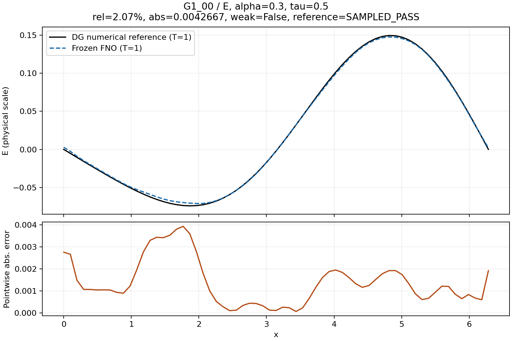
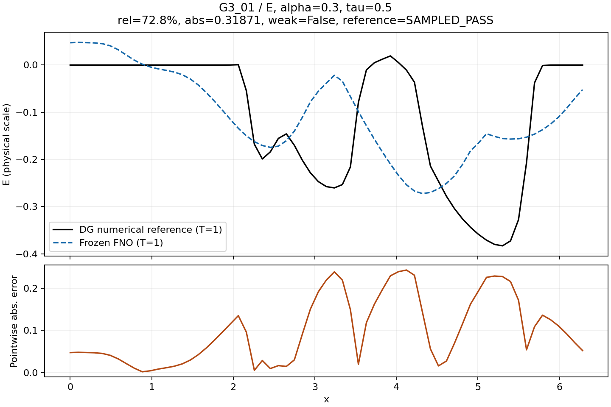

# Maxwell Cole–Cole FNO with DG reference data

一维无源 Maxwell–Cole–Cole 方程的 Fourier Neural Operator 代理建模实验。项目包含 C++ DG–RK-CQ 参考求解器、512 条训练与评测轨迹、PyTorch FNO、受控损失对照，以及冻结模型的新材料／新初值验收。

**当前结果：模型在三模态初值族上达到约 0.5%–1.2% 的逐场平均相对误差；对未见的平滑紧支撑脉冲，平均误差约 42%–67%，未通过泛化门槛。** 这是包含成功与失败证据的研究原型，尚不支持任意初值或全时域预测。

## 快速开始

推荐 Python 3.12。下载或克隆仓库后，在仓库根目录执行：

```bash
python3.12 -m venv .venv
source .venv/bin/activate
python -m pip install -r requirements.txt
python scripts/verify_release.py
python examples/demo.py --case G1_00
python examples/demo.py --case G3_01
```

验证脚本核查发布清单、数据划分、归一化、冻结权重加载，以及全部 64 条验收输入的预测回归；不训练、不求解 DG。示例重新执行 FNO，和保存的 DG 参考比较，在 `outputs/` 保存三场图、预测数组及误差。前一个示例来自三模态族，后一个来自未见函数族；均为已公开验收案例，不是新的独立测试。

推理不需要 C++ 工具链。重跑 DG 需要 CMake、C++17 编译器与 Boost。安装、训练、A/B 对照、DG 重算及验收命令见 [运行与复现](docs/RUNNING.md)。发布包附带完整的小规模数据和选定权重，不需要另外下载模型。

## 问题与实现

$$\epsilon_b E_t+P_t=H_x,\qquad \mu H_t=E_x,$$
$$\tau^\alpha\,{}^CD_t^\alpha P+P=\Delta\epsilon E.$$

区域为 $[0,2\pi]$，PEC 边界，$\epsilon_b=2$、$\mu=\Delta\epsilon=1$、$P_0=0$，从零历史开始。材料区间为 $\alpha\in[0.3,0.7]$、$\tau\in[0.5,2]$。网络学习 $(E_0,H_0,\alpha,\tau)\mapsto(E,H,P)(\cdot,T=1)$。

| 组成 | 实际设置 |
|---|---|
| 训练数据 | 8×8 个材料组合，每个材料 8 个独立三模态初值；共 512 条轨迹 |
| 划分 | 按材料组划分 384／64／64 条训练／验证／测试数据；48／8／8 个材料组 |
| 初值 | E 为前三阶正弦和，H 为前三阶余弦和，系数按 $U(-1,1)/m^2$ 抽样 |
| DG 标签 | 二次 DG（k=2）、64 单元、dt=0.0005；三阶段 Radau IIA（名义五阶）与 RK-CQ、完整 block-FFT 历史 |
| 数据输出 | 每条 11 个时刻、3 个场、65 个空间点；FNO 只学习 T=1 |
| FNO | neuraloperator 2.0.0；5 输入通道、3 输出通道、宽度 32、4 层、n_modes=[16]、padding=0.125 |
| 尺度 | 仅训练集的逐场空间加权 RMS；保留物理幅值；不逐样本归一化 |
| 当前展示权重 | epoch 2478 基线之后的受控 A 组，step 4224；以验证指标选出 |

`n_modes=[16]` 在此固定库版本的实 FFT 末维实际保留 9 个系数；这不意味着整个网络输出严格带限。当前实现没有额外强制 E/P 端点投影，H 也不作端点归零。名义时间阶数不等于所有数据的实测收敛阶。

## 冻结模型结果

以下为 2026-09-24 保存的四组验收，每组 4 个材料、每材料 4 条初值。平均相对 L2 在原 65 点上用梯形权重计算；不是连续函数上的误差证明。

| 组别 | E 平均误差 | H 平均误差 | P 平均误差 | 三场同时 ≤5% | 状态 |
|---|---:|---:|---:|---:|---|
| G1 已见材料＋新抽三模态初值 | 0.823% | 1.16% | 1.00% | 16/16 | 数值门槛初步满足，人工复核未关闭 |
| G2 新材料＋配对三模态初值 | 0.527% | 0.889% | 0.587% | 16/16 | 数值门槛初步满足，人工复核未关闭 |
| G3 已见材料＋新脉冲初值 | 49.2% | 67.3% | 42.1% | 0/16 | 未通过 |
| G4 新材料＋配对脉冲初值 | 49.5% | 66.5% | 41.8% | 0/16 | 未通过 |

新材料只检验了训练凸包内的指定设计，不代表整个参数矩形。配对案例不能视为独立材料重复；有限样本计数不是总体成功率保证。参考状态 `SAMPLED_PASS` 来自预定样本的时空细化，并非逐条严格认证。

[完整验收报告](evidence/acceptance/REPORT_验收结论.md) · [逐案例指标](evidence/acceptance/per_case_metrics.csv) · [结果解释与限制](docs/RESULTS.md)




## 计时与结论边界

历史记录中，CPU 单线程常驻 FNO 单条调用中位数约 0.743 ms；指定 N64/dt0.0005 DG 封装约 0.37 s，二者比值约 500。DG 封装包含投影、进程启动、文件 I/O 等，并且每个进程重新分解矩阵。**这不是相对最优同精度 DG 的 500 倍算法加速，也没有证明离线训练成本已经回收。** G3/G4 精度未通过，不能把其查询速度解释成合格求解的收益。

三模态基线已训练 2500 轮；随后 A/B 各完成 4800 次更新。A 组原 MSE 的验证主指标为 0.996813%，B 组混合损失为 1.004735%；没有证据表明这次混合损失整体更好。详见 [A/B 对照](fno_training/controlled_finetune/comparisons/comparison_20260924_135800_625457_b5d819/A_B_验证对照.md)。

## 仓库导航

| 路径 | 内容 |
|---|---|
| `src/`, `include/`, `vendor/` | C++ 数值内核、数据驱动与内核来源快照 |
| `reference/`, `data/` | 模态参考实现、原始小规模数据和采样表 |
| `fno_training/` | 数据处理、训练、推理、选定实验及受控 A/B 对照 |
| `fno_acceptance_v1/` | 冻结模型与一般初值验收代码；新运行输出写入 `artifacts/` |
| `evidence/` | 历史数据审计、冻结验收统计、预测、参考和图 |
| `examples/`, `scripts/` | 可运行示例与发布完整性／预测回归检查 |
| `provenance/` | 原始到发布版的文件映射、权重重打包记录与校验清单 |

发布整理日期为 2026-10-16。个人绝对路径已替换；模型参数、归一化和数据不因整理改变。文件重打包及精简范围见 [来源与发布说明](docs/PROVENANCE.md)，本次运行核验见 [发布核验](docs/RELEASE_CHECKS.md)。

当前各阶段完成情况和下一轮实验建议见 [开发状态与下一步](docs/DEVELOPMENT.md)。上传操作见 [GitHub 发布步骤](docs/PUBLISHING.md)。

## 方法来源与许可

FNO 使用官方 [neuraloperator](https://github.com/neuraloperator/neuraloperator) 实现。方法背景：[FNO 论文](https://arxiv.org/abs/2010.08895)、[神经算子框架](https://jmlr.org/papers/v24/21-1524.html)、[Cole–Cole DG](https://arxiv.org/abs/2208.11157)、[卷积求积](https://arxiv.org/abs/math/0504461)。这些是背景文献，本仓库的 DG–RK-CQ 与 block-FFT 组合不等同于后两篇论文的具体算法；当前误差和速度结论以保存实验为依据。

本项目自有代码采用 [MIT License](LICENSE)。内核来源及第三方依赖说明见 [许可与来源](NOTICE.md)。第三方依赖保留各自许可证。
