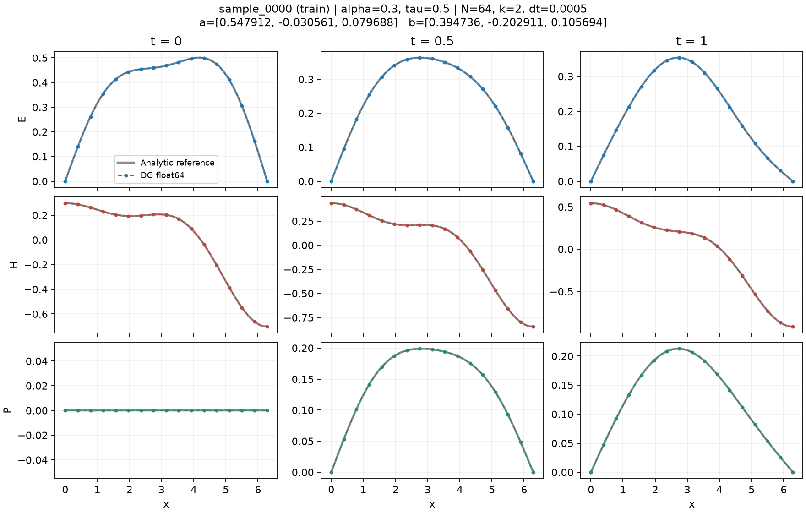

> 历史存档：以下内容写于数据生成阶段，“未训练”不描述当前项目。发布整理只修正了相对链接和个人路径；部分原始运行目录未随包提供。当前状态请见根目录 README。

# FNO教学数据（未训练网络）

输入为 α、τ、E₀、H₀；标签是无源 Cole–Cole Maxwell 的 **DG数值参考解** E/H/P。PEC边界，L=2π，ε_b=2、μ=Δε=1、P₀=0。

α在[0.3,0.7]等距取8值，τ在[0.5,2]对数等距取8值，每个材料组独立抽8组初值：E₀为前三阶正弦和，H₀为余弦和，系数独立U(-1,1)/m²，种子42。共512条；按材料组划分训练/验证/测试384/64/64条。

C++双精度DG–RK-CQ逐条求解：N=64、k=2、Δt=0.0005、T=1，完整历史，初值L²投影。Python负责组织和核验，不使用100位运算。11帧、65点；内部界面取两侧迹平均，端点取内侧迹。

`data/dataset.npz`：`fields[512,11,3,65]`依次为样本、时间、E/H/P、位置；`initial_fields[512,3,65]`是连续初值，`initial_coefficients[512,2,3]`是E/H三模态系数；另存α、τ、x、times、编号和split，保留物理尺度。

每帧三场与对应解析解作逐单元24点Gauss的L²比较，全部满足 **误差≤10⁻⁶+0.001×精确场范数**。E/H/P最大相对误差为0.00604%/0.00629%/0.00571%；零范数只报绝对误差。物理数据有限，无重复完整输入或材料划分交叉。解析求值交叉差异≤2.38×10⁻¹¹；另3例细化也通过。不是严格误差保证，尚无模型泛化结论。

在本目录运行（需CMake、Boost；默认借用相邻项目Python环境）：

```bash
bash run.sh --workers 2
```

```python
import numpy as np
d = np.load("data/dataset.npz", allow_pickle=False)
y_train = d["fields"][d["split"] == "train"]
```

参数见 `config.json`，样本表见 `data/samples.csv`，原始输出/日志见 `runs/`，逐项误差见 `checks/l2_errors.csv`。参考值 `exact_fields` 仅核验用。推导与细网格结果说明见 [问题与验证](../docs/reference_validation.md)。


